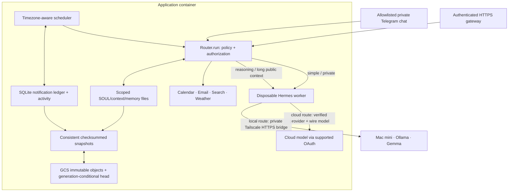

# Hybrid AI Agent

### Explainable LLM routing. Durable memory. Proactive workflows.

A Python assistant that chooses between **local Gemma inference** and a **cloud
reasoning model**, then uses real tools and durable state to do useful work.
It combines a secure Telegram interface, calendar/email/search/weather adapters,
scheduled briefings, deduplicated alerts and restart-safe fictional memory.

The engineering focus is the system around the model: selecting and verifying a
backend, containing failures, enforcing permissions, and recovering state without
replaying notifications. This is application code built on **Nous Research Hermes**,
not a reimplementation of that framework.

> This portfolio candidate grew out of USC CSCI 599 (Agentic AI). It contains no
> production credentials, deployed URL, private account data or operational logs.
> The professor has granted permission to publish this implementation. The code
> is prepared locally; no public remote has been created yet. [Origin and AI assistance →](docs/PROVENANCE.md)

## Architecture



In the original deployment, the **cloud container ran the assistant**: Telegram
polling, gateway, routing, skills, memory and scheduler. The **Mac mini only served
private inference**. Ollama stayed on loopback, behind a restricted Tailscale
proxy. This public copy is not connected to that deployment.

## What the project demonstrates

| Area | Implementation |
|---|---|
| Hybrid inference | Explainable privacy/reasoning/context rules; bounded retries; eligible local↔cloud fallbacks; private requests held when local inference fails |
| Verified execution | Successful attempts validate provider, wire model, endpoint and API mode rather than trusting the intended route |
| Safe messaging | User allowlist, private-chat checks, per-chat isolation, bounded input/history, duplicate-update handling and graceful shutdown |
| Real integrations | Calendar events/gaps/conflicts; read-only email summaries/urgency/unsent drafts; source-attributed search; real weather with schema validation/fallback |
| Persistent context | Bounded explicit preference writes, scoped namespaces, Hermes-compatible SOUL/context files; `/new` preserves memory |
| Proactive behavior | Scheduled briefings/recaps and calendar/urgent-mail polling; restart-safe SQLite deduplication and bounded delivery retries |
| Durable storage | Consistent SQLite backup + memory bundles, immutable GCS snapshots, checksums, ownership leases and conditional head updates |
| Security | Password-before-agent gateway, malformed request defenses, sanitized metadata, isolated workers and disabled email sending |

Tools run through assignment-owned adapters. A weather reply is a **tool execution**,
not evidence that either model ran. The scheduler uses ordinary code for scheduling,
urgency and calendar calculations instead of spending model calls on deterministic work.

## Try it without accounts or models

Prerequisites: Git, [uv](https://docs.astral.sh/uv/) and Python 3.14 (3.14.4 tested).
From a checkout of this repository:

```sh
uv sync --frozen --python 3.14
uv run --frozen python scripts/demo.py
uv run --frozen python scripts/test_offline.py
uv run --frozen python -m benchmarks.verify
```

The demo exercises the actual routing policy and temporary memory filesystem; it
does **not** pretend to generate model replies. Tests use synthetic transport
fixtures, a neutral home and denied network access. No cloud account, Telegram
bot, OAuth profile or Ollama process is needed. Optional pinned-Hermes tests skip
when its separate checkout is absent.

[Setup](docs/SETUP.md) covers a new Hermes checkout, independent model profiles,
Telegram, the synthetic-account restrictions and optional live operation.
No setup command starts a bot or provisions a cloud resource automatically.
The framework remains an optional, separately licensed dependency at a fixed commit.

## Verification snapshot

The fresh **local Git clone** snapshot passed **243 tests**, with **17 optional
Hermes tests skipped**, in a credential-free environment. After adding release-check
regressions, the latest suite with the separately installed pinned Hermes dependency
passed **260 tests**, with **six live-model tests skipped**. No production inference or cloud call was made.

Core dependency compatibility passes. The optional framework has a documented
Pillow override that raw `uv pip check` flags; this is reported, not hidden.
A current online vulnerability-advisory scan remains blocked by network/tool
availability. [Exact verification scope →](reports/verification.json)

## Routing design

| Signal | Normal choice | Failure behavior |
|---|---|---|
| Private flag or recognized privacy pattern | Local | Held if local cannot serve; no silent cloud fallback |
| Complex reasoning | Cloud | Local 429 fallback requires the corresponding explicit policy permission |
| Long public context | Cloud | Never bypass the local admission budget to force a fallback |
| Simple task within budget | Local | Eligible local failure can use cloud |
| Other public requests | Cloud | Eligible rate limits may use local |

The defaults in [`router/policy.json`](router/policy.json) use 24,000 UTF-8 bytes
for long-context classification, 48,000 for local input admission, one bounded
retry and a 120-second attempt timeout. **Bytes are not tokens.** Privacy rules
run before complexity rules. History contributes to classification, and private
session state stays private across turns. Regex classification has limits; it is
not a universal data-loss-prevention system.

The adapter selects the complete Hermes runtime before inference. It does not
assume a pre-call hook can swap providers. The worker disables framework-native
fallbacks/tools and automatic OAuth refresh, then validates the actual execution
metadata returned through its private IPC channel. [Design details →](docs/ARCHITECTURE.md)

## Measured behavior, including the weak results

A retained six-request pilot compared **Gemma 4 E2B** on an Apple M4/16 GiB Mac
with **GPT-5.6 Sol** through the supported Codex OAuth path:

| Identical synthetic task | Gemma seconds | Strict score | GPT seconds | Strict score |
|---|---:|---:|---:|---:|
| Simple facts/arithmetic | 38.115 | 0/4 | 7.708 | 4/4 |
| Multi-step dependency planning | 62.128 | 0/4 | 8.562 | 4/4 |
| Context-heavy ledger extraction | 20.485 | 0/4 | 7.733 | 4/4 |

These are **one native Hermes-worker measurement per model/task**, including
framework startup—not deployed HTTP or Telegram latency. Both backends were
forced for paired comparison; this is not six automatic-route measurements.
Gemma wrapped every answer in Markdown fences, failing the original strict-JSON
rule. A separate, labelled fence-stripping diagnostic gives 4/4, 3/4, 3/4; planning
and context also contain factual errors. The recorded scores are not rewritten.

All six calls completed without cross-model fallback. Cache/warmth was uncontrolled,
actual OAuth charges are unknown, and no p95 or general speed claim is supported.
Local routing serves privacy/resource choices; this pilot does **not** show a
local latency advantage. [Method, token counters and limitations →](docs/BENCHMARKS.md)

## Stack and repository map

**Python · Hermes AIAgent · Ollama · Telegram Bot API · SQLite · Google Cloud
Storage · Cloud Run Instances · Tailscale · unittest**

```text
router/             Policy, fallbacks, worker isolation and execution validation
telegram_bot/       Admission, sessions, long polling and delivery
assignment_skills/  Real calendar/email/search/weather adapters
agent_memory/       Scoped persistent SOUL/context files
proactive/          Briefings, recap, alert rules and durable ledger
persistence/        Local/GCS objects, snapshots, leases and restoration
operations/         Health, activity, gateway and private inference bridge
benchmarks/         Fixed cases, original synthetic results and score replay
examples/           Empty credentials and fictitious configuration
skills/             Tool-use instructions and permission boundaries
deploy/             Sanitized container and deployment-reference templates
tests/              Deterministic fixtures and optional Hermes integration
scripts/            No-network demo, test runner and publication scanner
```

Legacy internal names and synthetic-account guards deliberately remain visible;
this is a truthful portfolio adaptation, not a claim of unrelated commercial origin.

## Tradeoffs and boundaries

- **Rules over a classifier model:** fast and explainable, but regexes can miss meaning.
- **Disposable workers:** contain framework state at the cost of startup overhead.
- **Deterministic tool adapters:** enforce data provenance and permissions, with less
  autonomous tool selection than a general-purpose agent loop.
- **SQLite + snapshots:** small operational footprint; recovery needs correct leases,
  consistent backups and careful treatment of ambiguous Telegram delivery.
- **Single cloud process:** simpler ownership; not an active-active/high-availability design.
- **Read-only email:** useful summaries and drafts; sending is deliberately disabled.

Container manifests and GCS adapters are engineering artifacts, not a promise of a
one-command production deployment. No container build, new cloud round-trip, fresh
live inference or sustained uptime test was performed for this sanitized copy.
No 48-hour availability claim is made. [Deployment boundaries →](docs/DEPLOYMENT.md)

## Ownership, license and security

Author: **Chidubem Ezenna**. Origin: **USC CSCI 599, Agentic AI**.
Codex/ChatGPT assisted substantially with code drafts, debugging, tests and writing;
I set requirements, configured dedicated test accounts, ran external verification
and reviewed results. Exact development-model versions are not reliably recorded.
[Detailed attribution →](docs/PROVENANCE.md)

The application code is MIT-licensed; the grant covers the author's application
implementation, not separately licensed dependencies or model weights. Hermes is maintained by Nous Research under its own MIT license;
its source/history is not included. Model weights, third-party libraries and API
content retain their own terms. [Third-party notices →](THIRD_PARTY_NOTICES.md)

See [SECURITY.md](SECURITY.md) for controls and reporting limitations, and
[PUBLICATION_REVIEW.md](docs/PUBLICATION_REVIEW.md) for scan/test results,
excluded material and remaining pre-publication checks. Do not publish secrets or
use the submitted agent's bot, accounts, cloud resources or private network.
